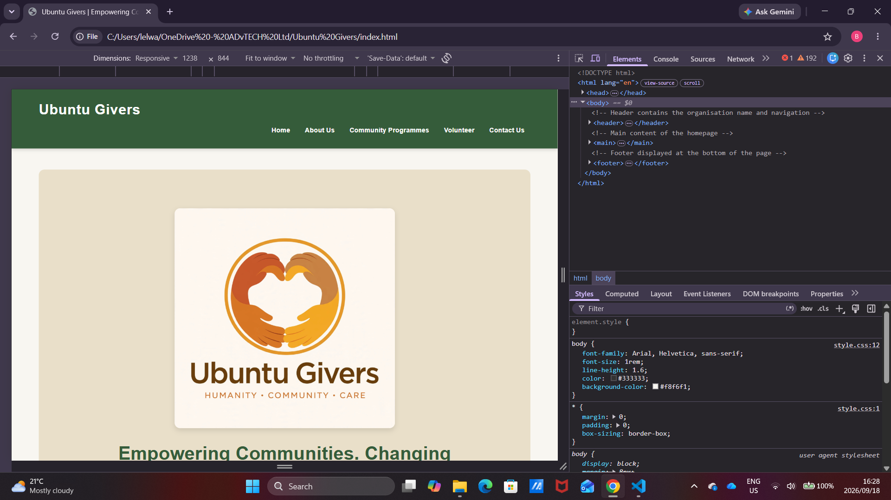
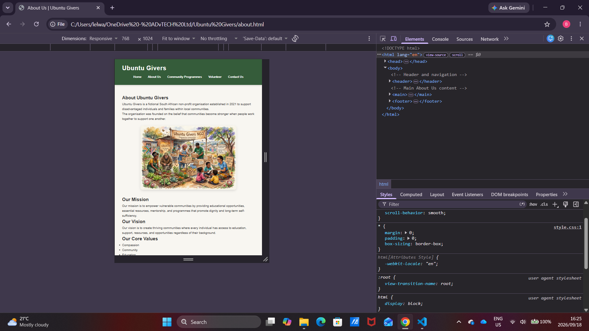
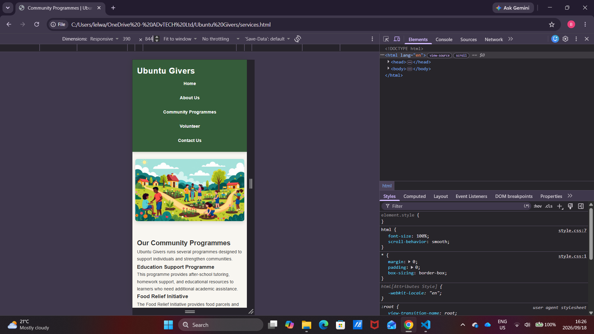

# Ubuntu Givers

## Student Information

**Student Name:** Bulelwa Maphatswana
**Course:** Diploma in Information Technology – Software Development
**Institution:** Rosebank College
**Module:** WEDE5020
**Project:** Ubuntu Givers Website

## Project Overview

Ubuntu Givers is a fictional non-profit organisation that supports disadvantaged individuals and families within the community.

The organisation focuses on providing assistance through food support, clothing donations, educational support and community outreach programmes. The website was designed to provide visitors with information about the organisation, its programmes and how they can become involved.

The website reflects the values of Ubuntu, including compassion, community support, generosity and helping others.

## Website Goals and Objectives

The main goals of the website are to:

* Introduce visitors to Ubuntu Givers.
* Explain the organisation's purpose and values.
* Provide information about community programmes.
* Encourage visitors to volunteer.
* Provide contact information for enquiries.
* Present information in a clear, accessible and user-friendly way.
* Ensure the website can be viewed on desktop, tablet and mobile devices.

## Website Pages

The website consists of five HTML pages:

1. **Home** – Introduces Ubuntu Givers and provides an overview of the organisation.
2. **About Us** – Provides information about the organisation, its purpose and values.
3. **Community Programmes** – Describes the programmes and services provided by Ubuntu Givers.
4. **Volunteer** – Allows visitors to submit information if they are interested in volunteering.
5. **Contact Us** – Provides contact and location information.

## Key Features and Functionality

The website includes:

* Five linked HTML pages.
* A consistent navigation bar.
* External CSS styling.
* Responsive page layouts.
* Flexbox for navigation and page alignment.
* CSS Grid for programme and location layouts.
* Responsive images.
* Styled forms and form controls.
* Buttons and interactive links.
* Hover, focus and active states.
* Consistent colours, typography and spacing.
* Desktop, tablet and mobile layouts.

## Part 1

Part 1 focused on planning and developing the initial HTML structure of the Ubuntu Givers website.

The following work was completed:

* Organisation proposal completed and approved.
* Website content and structure planned.
* Five HTML pages created.
* Navigation between pages implemented.
* Initial website content added.
* GitHub repository created.
* README documentation created.

The feedback received from Part 1 was reviewed before continuing with Part 2. Any required improvements were incorporated into the website during the development process.

## Part 2 – CSS Styling and Responsive Design

Part 2 focused on improving the visual design of the Ubuntu Givers website using CSS and responsive design techniques.

### CSS Styling

An external stylesheet named `style.css` was created in the `css` folder and linked to all five HTML pages.

The stylesheet includes:

* CSS reset.
* Default font family and font sizing.
* Website colours and backgrounds.
* Typography and spacing.
* Header and navigation styling.
* Flexbox layouts.
* CSS Grid layouts.
* Buttons and links.
* Borders and border-radius.
* Box shadows.
* Hover, focus and active states.
* Form styling.
* Responsive image styling.

### Responsive Design

Media queries were used to adapt the website to different screen sizes.

The website includes layouts for:

* Desktop screens.
* Tablet screens.
* Mobile screens.

Relative units such as `%`, `rem` and `em` were used where appropriate to support responsive design.

Responsive images were implemented using HTML image techniques, including `picture`, `srcset` and `sizes`, allowing images to adapt to different screen sizes.

### Responsive Breakpoints

The following breakpoints were implemented:

* **Tablet:** `max-width: 900px`
* **Mobile:** `max-width: 600px`

At smaller screen sizes, the programme and location grids change from multiple columns to a single-column layout. The navigation also changes to a vertical layout on mobile devices.

### Testing

The website was tested at different screen sizes using browser developer tools.

The following areas were checked:

* Navigation links.
* Page layout.
* Text readability.
* Images.
* Buttons.
* Forms.
* Programme cards.
* Location cards.
* Mobile navigation.
* Responsive grid layouts.

Screenshots of the website at desktop, tablet and mobile sizes are included below.

## Part 2 Changes

The following changes were made during Part 2:

* Added an external CSS stylesheet.
* Linked the stylesheet to all website pages.
* Added a CSS reset.
* Added consistent colours and typography.
* Styled the navigation bar.
* Added Flexbox layout techniques.
* Added CSS Grid layouts.
* Added borders, shadows and spacing.
* Added hover, focus and active states.
* Styled forms and buttons.
* Added responsive images.
* Added tablet and mobile media queries.
* Adjusted image sizing and positioning.
* Added spacing between the navigation area and images.
* Improved the overall visual presentation of the website.
* Reduced repeated CSS rules while maintaining the original design.
* Tested the website at desktop, tablet and mobile screen sizes.

### Part 3: Enhanced Features

- **JavaScript programme search:** Users can search and filter community programmes by entering keywords.
- **Interactive FAQ accordion:** Users can click frequently asked questions to display their answers.
- **Enquiry form validation:** Required fields and input formats are checked, with feedback tailored to the selected enquiry type.
- **Contact form validation:** The form validates user input and prepares an email containing the message details for the user to review and send.
- **Search engine optimisation (SEO):** Each page has a descriptive page title and meta description. Image alternative text and semantic HTML headings support accessibility and search visibility.
- **SEO files:** Added `robots.txt` and `sitemap.xml` to support search engine crawling and indexing once the website is deployed.
- **Responsive design:** The website was tested in a mobile-sized browser view.
- **Added an interactive Google Maps embed to the Contact page, displaying Johannesburg as the organisation's general service area. The map is responsive and was tested on desktop and mobile devices.
- **Added CSS transitions and hover effects to buttons, links and programme cards.
- **Added a fade-in keyframe animation to improve page-loading presentation.
- **Added a community image gallery to the homepage featuring programme, community and volunteer images.
- **Implemented an interactive lightbox that allows visitors to enlarge gallery images and close them using the close button, clicking outside the image or pressing Escape.
- **Added responsive gallery styling to display images neatly on desktop and mobile devices.
 
## Testing Screenshots

### Desktop View

### Tablet View

### Mobile View

---

## Sitemap

The website structure is:

Ubuntu Givers
│
├── Home
├── About Us
├── Community Programmes
├── Volunteer
└── Contact Us

## Project Structure

The main project structure includes:

Ubuntu Givers

├── css
│   └── style.css
├── javascript
│   └── script.js
├── images
│   └── website images and screenshots
├── index.html
├── about.html
├── services.html
├── enquiry.html
├── contact.html
└── README.md

## Changelog

### Part 1

* Created the initial Ubuntu Givers website structure.
* Created five HTML pages.
* Added website content and images.
* Added navigation between pages.
* Created the GitHub repository.
* Added initial README documentation.

### Part 2

* Reviewed and implemented required Part 1 feedback.
* Created and linked the external `style.css` stylesheet.
* Added CSS reset and base styling.
* Added typography, colours and spacing.
* Styled the header and navigation.
* Implemented Flexbox and CSS Grid layouts.
* Styled buttons, links and forms.
* Added hover, focus and active states.
* Added responsive image functionality.
* Added tablet and mobile media queries.
* Improved layouts for smaller screens.
* Adjusted image sizing and positioning.
* Tested the website using browser developer tools.
* Added desktop, tablet and mobile screenshots.
* Updated the README with Part 2 documentation and testing evidence.

### Part 3 — Enhancing Functionality and SEO

* Added JavaScript functionality to search and filter community programmes.
* Added an FAQ accordion to the About page.
* Improved enquiry and contact forms with HTML5 validation and JavaScript feedback.
* Added functionality to prepare contact emails using the user's email application.
* Updated page titles and meta descriptions for SEO.
* Reviewed image alternative text and homepage HTML structure.
* Added `robots.txt` and `sitemap.xml`.
* Tested the website's main pages and checked the layout in a mobile-sized browser view.
- Added a responsive community image gallery to the homepage.
- Added JavaScript lightbox functionality with click-to-open, close-button, outside-click and Escape-key support.
- Added CSS styling for the gallery and lightbox.

## References

The following resources were consulted during the development of the website:

*Mozilla Developer Network, 2024. HTML: HyperText Markuo Language. Available at: developer.mozilla.org [Accessed 18 September]
* The IIE, 2026, WEDE5020 Module Manual 2026. Johannesburg: The Independent Institute of Education
* W3Schools, 2024. CSS Tutorial. Available at w3schools.com [Accessed 18 September]

## GitHub Repository

The completed Ubuntu Givers website and source files are available in the project's GitHub repository.

**GitHub Repository:** [Ubuntu Givers Part 3 – Summative Assignment](https://github.com/Bulelwa05/Ubuntu-Givers-Part-3-Summative-Assignment-)

**Live Website:** [View the Ubuntu Givers Website](https://bulelwa05.github.io/Ubuntu-Givers-Part-3-Summative-Assignment-/)

**GitHub Repository:** https://github.com/Bulelwa05
